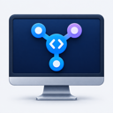
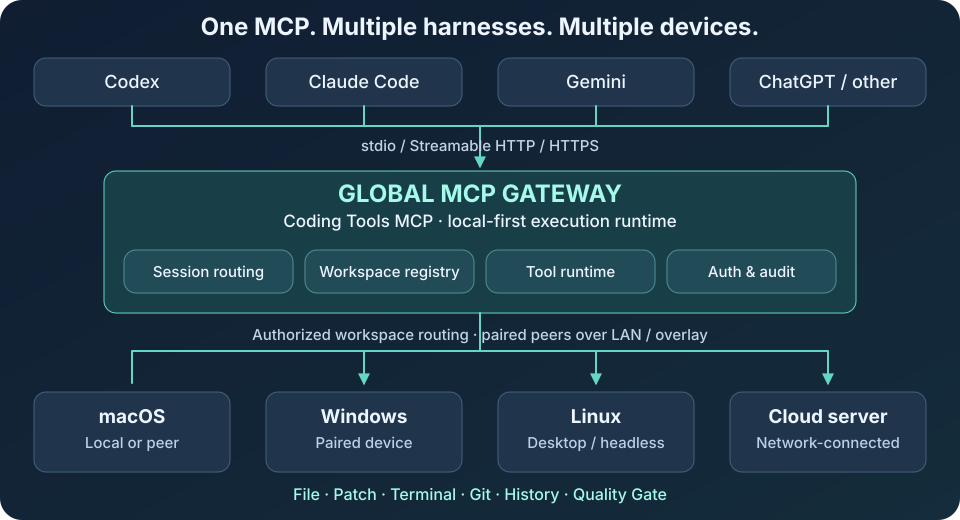
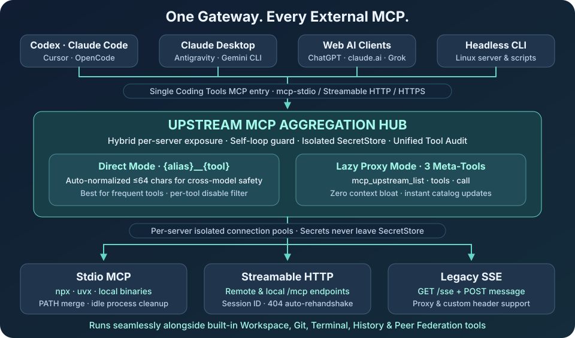
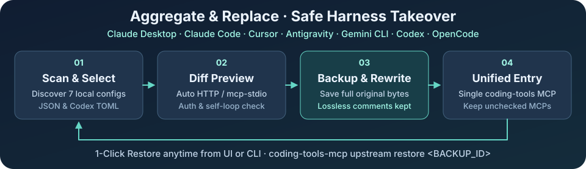
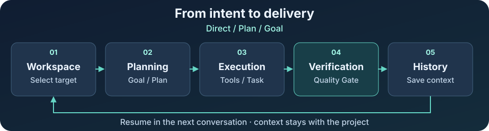

<p align="center">
  
</p>

<h1 align="center">Coding Tools MCP</h1>

<p align="center">
  Connect once. Develop across all your devices and aggregate every external MCP behind one gateway.
</p>

<p align="center">
  <a href="https://github.com/lengsukq/coding-tools-mcp/releases/latest"></a>
  
  
  
  <a href="https://www.apache.org/licenses/LICENSE-2.0"></a>
</p>

<p align="center">
  <a href="README.md">中文</a> · <a href="README.en.md">English</a> · <a href="https://github.com/lengsukq/coding-tools-mcp/releases/latest">Download latest</a>
</p>

Coding Tools MCP is a **local-first, cross-device AI development runtime, independent of the model and agent harness**. Connect once over MCP to access authorized workspaces on your own machine, peer computers and cloud servers, and carry real software engineering work across conversations.

<p align="center">
  
</p>

**One MCP endpoint · Multiple harnesses · Multiple devices · MCP aggregation & takeover · Persistent project context**

[Quick start](#get-started-in-five-minutes) · [MCP aggregation & takeover](#aggregate-all-external-mcps-behind-one-endpoint) · [Linux headless deployment](docs/linux-headless.md) · [Harness setup (Chinese)](docs/harness-connectors.md) · [Web AI connectors](docs/web-chat-connectors.md) · [Architecture](docs/project-context/architecture.md)

## Core capabilities

| Feature | What it enables |
| --- | --- |
| **MCP-compatible harnesses** | Connect compatible clients such as Codex, Claude Code and Gemini using the native Rust `mcp-stdio` bridge or Streamable HTTP; web AI clients can use HTTPS MCP. |
| **Multi-device federation** | Discover paired devices from one Global MCP endpoint and read, edit, run commands and test across macOS, Windows, Linux and network-connected cloud servers. |
| **MCP aggregation & takeover** | Mount third-party Stdio, Streamable HTTP and Legacy SSE MCP servers behind one endpoint with mixed Direct (`{alias}__{tool}`) and 3-meta-tool Lazy Proxy modes, per-tool filtering, isolated secrets, 7-harness scanning, and backup-protected Aggregate & Replace. |
| **Multiple workspaces and sessions** | Manage many projects through one connection, with independent workspace selection per MCP session and explicit `workspace_id` routing. |
| **Agent execution framework** | Direct / Plan / Goal modes with goals, plans, tasks, execution evidence and human acceptance. |
| **Persistent project memory** | Project-local History with state recovery, search and paginated reading; continue work across AI conversations and clients. |
| **Engineering verification** | Files, patches, terminal, Git, Skills and Quality Gate share one runtime, with code review and execution records. |
| **Native Computer Use** | Opt-in macOS screen observation, guarded pointer/keyboard input, peer forwarding, sensitive-action confirmation and emergency pause. |
| **Linux headless** | Standalone x64 / ARM64 binary without GTK desktop dependencies, CLI, one-line installation, systemd and repository discovery. |
| **Connectivity and governance** | OAuth, PKCE, DCR, Bearer, HMAC pairing, FRP / Cloudflare tunnels, tool auditing, health checks and a global Dashboard. |

## Connect once. Develop across your devices.

Local harnesses can connect to `http://127.0.0.1:<port>/mcp` directly or use the native `mcp-stdio` bridge without Node.js or a public tunnel. Remote AI clients can use HTTPS MCP. Paired peers communicate over LAN or overlay networks such as EasyTier / Tailscale, so you do not have to configure a separate AI connection for every machine.

### Everyday use: one main computer, your entire development environment

Imagine you have a MacBook for daily work, an always-on Mac mini at home, a Windows test machine, and a Linux cloud server.

Set up your preferred AI harness (such as Codex, Claude Code or Gemini CLI) once on your MacBook and connect it to Coding Tools MCP. On the other devices, simply run Coding Tools MCP (or Linux Headless), pair them and share the relevant projects. There is no need to install and configure a separate harness, model API key or MCP client on each execution device.

| Device | Everyday role |
| --- | --- |
| MacBook · main computer | Run your harness and issue development instructions |
| Mac mini · home development machine | Edit projects and build macOS / iOS apps |
| Windows · test machine | Build Windows apps and run platform-specific tests |
| Linux · cloud server | Develop backend services, inspect logs and maintain services |

In a single AI conversation, you can ask: “Update the project on my Mac mini, run the tests on Windows, then inspect the service logs on my Linux server.” The AI selects each target workspace through MCP, and file and command operations execute on the target device.

**Configure your harness once. Pair new devices as needed. Change models or harnesses without reconfiguring every execution device.** Multiple compatible clients can also connect to the same gateway with independent workspace context.

> Clients must support the relevant MCP transport and authentication. Target devices must be online and share authorized workspaces. Only calls through MCP are routed remotely; a harness's built-in shell and editor do not automatically become remote tools. Compatibility can vary by client.

## Aggregate all external MCPs behind one endpoint

Stop maintaining duplicate `mcpServers` blocks across Codex, Claude Code, Cursor, Claude Desktop, Gemini CLI, OpenCode and web AI connectors. Mount your external MCP servers once inside the built-in **Upstream MCP Aggregation Hub**, and every client connected to Coding Tools MCP can use them through a single endpoint.

<p align="center">
  
</p>

- **All three transports**: Native support for **Stdio** (`npx` / `uvx` / local binaries with global `PATH` merge and idle cleanup), **Streamable HTTP** (session tracking and HTTP 404 auto-rehandshake), and **Legacy SSE**, with isolated per-server pools so one slow upstream never blocks built-in or sibling tools.
- **Hybrid Direct + Lazy Proxy exposure (per server)**:
  - **Direct mode (`direct`)**: Exposes tools directly with normalized `{alias}__{tool}` names (≤64 chars, cross-model safe) for one-step calls;
  - **Lazy Proxy mode (`proxy`)**: Exposes only 3 constant meta-tools (`mcp_upstream_list`, `mcp_upstream_tools`, `mcp_upstream_call`) to avoid context bloat and web-client tool limits while reflecting changes immediately.
- **Security and observability**: Per-tool disable toggles, isolated credential storage in `SecretStore` (env secrets, headers and bearer tokens are never echoed back), self-loop blocking, and unified Tool Audit attribution (`upstream:<alias>`).

### Aggregate & Replace: one-click takeover for 7 local harnesses

In **Settings → Connection & Federation → MCP Aggregation Hub → Scan / JSON Import** (or via CLI), you can scan existing local client configs and opt into **Aggregate & Replace** to consolidate them safely:

<p align="center">
  
</p>

| Supported harnesses for scan & takeover | Config format | Default takeover mode (`auto`, switchable to `http` / `stdio`) |
| --- | --- | --- |
| **Codex** | `~/.codex/config.toml` (lossless section rewrite keeping comments) | Local HTTP when local no-auth is enabled, else `mcp-stdio` |
| **Cursor** / **Claude Code** / **OpenCode** | Respective JSON configs (`mcpServers` / `mcp`) | Local HTTP when local no-auth is enabled, else `mcp-stdio` |
| **Claude Desktop** / **Antigravity** / **Gemini CLI** | Respective JSON `mcpServers` configs | Native `mcp-stdio` bridge |

- **Transparent diff preview & lossless edits**: Shows per-file removals, exact injected snippets and auth preflight warnings before writing; removes only the selected imported entries while preserving unrelated settings and unchecked MCPs, and skips duplicate injection if a Coding Tools MCP entry already exists.
- **Automatic full-file backup & 1-click restore**: Saves exact original bytes to `data/harness-backups/` (retaining up to 40 backups) so any file can be restored with one click in the UI or via CLI.

```bash
# Scan 7 local harnesses; add --yes to import and --replace to back up & rewrite to one unified entry
coding-tools-mcp upstream import --scan --yes --replace --connect-mode auto

# List takeover backups and restore any original client config anytime
coding-tools-mcp upstream backups
coding-tools-mcp upstream restore <BACKUP_ID>

# Manage upstream MCP servers on Linux headless servers or scripts
coding-tools-mcp upstream add github --http https://api.githubcopilot.com/mcp/ --bearer "$TOKEN" --mode proxy
coding-tools-mcp upstream list
```

## From intent to delivery, across conversations

<p align="center">
  
</p>

- **Direct** for small tasks, **Plan** for structured work, and **Goal** for long-running, acceptance-driven development.
- Use the Execution Ledger, Quality Gate, Git Diff / Review and tool audits to check results rather than relying on an AI completion claim.
- Save progress and decisions in project-local History; restore context on demand in the next conversation.

The runtime is independent of the upper-level model and harness. Reasoning and task orchestration remain the responsibility of the connected AI client; this project does not provide its own model inference or autonomous distributed multi-agent scheduler.

## Understand the workflow in 30 seconds

1. Install the desktop app or Linux headless service and add project directories.
2. Start Global MCP; pair devices and share workspaces for cross-device development.
3. Connect an AI client using local stdio / HTTP or public HTTPS MCP.
4. Call `workspace_list`, select a project with `workspace_select` or an explicit `workspace_id`, and start developing.

[Full setup](#get-started-in-five-minutes) · [ChatGPT configuration](#mcp-connector) · [Linux deployment](docs/linux-headless.md) · [Detailed capabilities and architecture](docs/project-context.md)

## Get started in five minutes

### 1. Install the client (Desktop or Linux Headless Server)

Open [Releases](https://github.com/lengsukq/coding-tools-mcp/releases/latest) and download the package for your platform, or use the one-line installer on Linux servers:

| Platform | Package / Installer |
| --- | --- |
| Windows 10/11 x64 | `Coding.Tools.MCP_*_x64-setup.exe` |
| macOS (Intel + Apple Silicon) | `Coding.Tools.MCP_*_universal.dmg` |
| Linux Desktop (x64) | `*.deb` / `*.AppImage` |
| Linux Headless Server (x64 / ARM64, zero GTK) | `coding-tools-mcp-v*-linux-*-headless.tar.gz` or one-line script below |

The macOS build is currently unsigned. If macOS blocks the first launch, allow it from System Settings → Privacy & Security.

#### One-line Linux headless install

```bash
# Install the headless binary (auto-detects x86_64 / aarch64)
curl -fsSL https://raw.githubusercontent.com/lengsukq/coding-tools-mcp/main/scripts/install-linux.sh | bash

# Install + enable systemd daemon + LAN federation + auto-discover ~/code repos + print 6-digit PIN
curl -fsSL https://raw.githubusercontent.com/lengsukq/coding-tools-mcp/main/scripts/install-linux.sh | \
  bash -s -- --service --lan --auto-root ~/code --pair-pin
```

Run with `sudo bash -s -- --service ...` for a system-level `systemd` unit (`/etc/systemd/system/coding-tools-mcp.service`), pass `--from-source` to build the zero-GTK binary from `main`, or pass `--mirror <URL>` to use a GitHub download mirror. See [docs/linux-headless.md](docs/linux-headless.md) for the complete CLI and deployment reference.

### 2. Add a project workspace

1. Click **Add workspace** in the sidebar.
2. Select the project root directory.
3. Configure the workspace name and save it. The workspace remains available in the sidebar across conversations and restarts.

### 3. Configure local bridge, LAN pairing, or public tunnel

- **Same Mac / local desktop hosts (recommended first)**: Open **Settings → MCP Connection** to use the local loopback endpoint (`http://127.0.0.1:<port>/mcp`), or use **Gemini App · MCP Connection → Local MCP** and click **Generate Credentials & Copy** to connect via the built-in native `mcp-stdio` bridge without any public tunnel.
- **Cross-device LAN collaboration**: Under **Settings → MCP Connection → LAN Multi-Device Pairing**, scan or probe peers and pair with a 6-digit PIN to access `{device_id}:{workspace_id}` across macOS and Windows machines.
- **Public remote access (ChatGPT / Gemini web / claude.ai / Grok)**: Configure public exposure under **Settings → MCP Connection**:
  - **Zero-setup default: Cloudflare Quick Tunnel.** Select Cloudflare Quick Tunnel to generate a `https://<random>.trycloudflare.com` public URL without an account (supports one-click forced restart in the UI). For long-term use, prefer FRP with a fixed subdomain or an external reverse proxy.
  - Install or detect `frpc` / `cloudflared` from **Settings → Network & Tools**.
  - Save the server, port, and token under **Settings → MCP Connection → FRP Server Configuration**, then select that profile and one subdomain in Global MCP Connection.

If you do not have an FRPS server yet, follow this [FRPS server installation guide (Chinese, WeChat)](https://mp.weixin.qq.com/s/kmpQhHsvmHlaLfj4rw3A0Q). After deployment, enter the server address, port, and token under **FRP settings** in the desktop client.

### 4. Start MCP

Open Dashboard or **Settings → MCP Connection** and click **Start Global MCP**. The desktop client shows:

- the single local MCP URL such as `http://127.0.0.1:28765/mcp`;
- the public HTTPS MCP URL;
- authentication and bridge details for ChatGPT / Gemini;
- live logs and per-check health results (verifying local and public endpoints, OAuth metadata, and the MCP protected-resource document, with recent MCP request logs viewable directly in the desktop app).

### 5. Connect an AI client

Beyond ChatGPT, any web client with a remote MCP connector can reach the same workspace — claude.ai, Grok, Gemini, and generic connectors included. See the [web chat connector matrix](docs/web-chat-connectors.md) for per-client configuration, authentication choices, and troubleshooting.

Use the public MCP URL shown by the app. OAuth now supports Authorization Code + PKCE S256, Dynamic Client Registration (`/register`), and Refresh Tokens. Clients with DCR support can register themselves from the server metadata; older clients can continue to use the static Client ID / Secret configured in the desktop app.

For a first connection, explicitly choose a Workspace first; history bootstrap is optional:

```text
workspace_list
workspace_select(workspace_id=...)
server_info
git_status
```

This keeps the agent from guessing the project from chat context. If a client cannot reliably preserve MCP Session state, use `workspace_invoke(workspace_id=..., tool=..., arguments=...)` for explicit one-off operations rather than repeatedly selecting or inferring a directory.

## Connect ChatGPT

### MCP Connector

Before configuring ChatGPT, make sure that:

1. Global MCP and the public tunnel are both running.
2. The public MCP endpoint passes the desktop health check. If OAuth is enabled, also verify the protected-resource document and authorization metadata.
3. You have copied the **Public MCP URL** from the desktop **GPT configuration** card. OAuth needs the authorization password; static Client ID / Secret values are only needed when the client does not support dynamic registration.

> ChatGPT must use the public HTTPS `/mcp` URL. A local address such as `http://127.0.0.1:28765/mcp` is not reachable from ChatGPT. After connecting, call `workspace_list` and `workspace_select` to choose the project context. Menu names may vary slightly by ChatGPT version and language.

#### 1. Enable ChatGPT developer mode

Open ChatGPT settings, go to **Account security and sign-in**, and enable **Developer mode**. This allows unverified MCP connectors to be added.


*Developer mode grants powerful access. Only connect MCP servers that you operate or explicitly trust.*

#### 2. Create the MCP plugin

Open **Plugins** from the ChatGPT sidebar, click the `+` button, select the MCP beta option, and enter:

| ChatGPT field | Value |
| --- | --- |
| Name | A recognizable name such as `Coding Tools MCP` |
| Description | A short description of the connected project or purpose |
| Connection | The public MCP URL from the desktop **GPT configuration** card; it should end in `/mcp` |
| Authentication | The same mode configured in the desktop app; the screenshot uses OAuth |


For OAuth, prefer Dynamic Client Registration when the client supports it and let the client register from the server metadata. If the client only supports static OAuth credentials, use the Client ID and Client Secret shown by the desktop app. When the authorization page opens, enter the authorization password from the desktop **GPT configuration** card.

> Client Secrets, authorization passwords, and Bearer tokens are sensitive. Never paste them into chats, issues, or public screenshots. If the desktop app uses Bearer or no authentication, select the matching option currently offered by ChatGPT.

#### 3. Verify the connection

Start a new conversation with the plugin enabled and ask:

```text
Use Coding Tools MCP to call workspace_list, select the coding-tools-mcp Workspace,
then call server_info and git_status. Tell me the active Workspace, MCP state, and Git status.
```

If ChatGPT returns information from the current project, the desktop app, public tunnel, authentication, ChatGPT, and MCP tool chain are connected end to end. History can be initialized explicitly when a client or workflow needs a dedicated archived session, but it is not a prerequisite for normal development.

If ChatGPT still shows an old tool list, disconnect and reconnect the plugin or verify again in a new conversation.

#### Troubleshooting

| Symptom | Check first |
| --- | --- |
| ChatGPT cannot connect | Confirm that the URL is the public HTTPS `/mcp` endpoint rather than `127.0.0.1`, and that the public MCP health check passes |
| OAuth authorization fails | Confirm that the Client ID, Client Secret, and authorization password come from the same workspace, and check the OAuth metadata results |
| New tools are missing | Disconnect and reconnect the plugin, then start a new conversation |
| A tool call fails | Open **Logs** and **Health checks** in the desktop app and confirm that the request reached the MCP service |

## Why use it

- **Built for real development**: files, commands, Git, tests, and retained processes live in one Workspace.
- **Cross-conversation continuity**: a new conversation starts from bounded current state and can search/read exact older archives only when they are needed.
- **Auditable progress**: structured checkpoints preserve decisions, changed files, test results, remaining issues, and next steps inside the project.
- **Multiple workspaces**: one Global MCP connection manages multiple local projects, while each Chat Session selects its own Workspace. There is no need to configure a separate MCP and public endpoint per project.
- **Direct ChatGPT connectivity**: Streamable HTTP, OAuth, Bearer tokens, FRP, and Cloudflare are built in.
- **A focused default tool surface**: stable core tools are available by default; advanced Harness capabilities are opt-in.

## Let the project remember every conversation

Chat transcripts are useful for rereading a discussion, but they are a poor long-term development handoff. Coding Tools MCP stores progress in `docs/history-session/` under the current project, so context follows the repository instead of staying trapped in one chat window.

The History Context panel controls current-session recording, multi-selects older sessions, previews the selected context, and clears selections. Applying a selection refreshes MCP context with only a bounded session index, recent checkpoints, key files, and selected snippets; the full Markdown archives remain in `docs/history-session/` and are searched/read on demand when exact older context is required.

The default `compact` profile exposes history through the Stable Tool API v2 `history_manage` aggregate entry point. The five lifecycle-specific names below remain available in compatibility profiles:

| Tool | Purpose |
| --- | --- |
| `history_session_bootstrap` | Initialize or restore a project session; preserve verbatim `initial_user_input` and return a stable `session_key`, `current_path`, and bounded current state instead of all history |
| `history_session_checkpoint` | Append structured progress and verbatim `raw_user_input` to the stable target returned by bootstrap; reject mismatched targets instead of writing to another history file |
| `history_session_validate` | Validate numbering, history files, and session mappings; rebuild derived indexes when needed without deleting existing history |
| `history_session_search` | Search lossless Markdown archives by deterministic keywords and return a bounded page of locations and snippets |
| `history_session_read` | Read one original Markdown archive losslessly in UTF-8-safe pages by number or a search result path; pages default to `16 KiB`, are capped at `64 KiB`, and continue with `next_cursor` |

History uses readable Markdown that can be backed up or committed with the project. `memory/state.json` is a bounded current-state projection, while `memory/manifest.json` stores only archive locations, hashes, and keywords; Markdown remains the lossless source of truth. ChatGPT must pass verbatim first-turn and per-turn text as `initial_user_input` and `raw_user_input`, because the server cannot inspect remote chat text that was not provided as a tool argument. Checkpoints are idempotent, changed content for the same `turn_id` is retained as a revision with supersession evidence, and progress should only be reported as saved after the tool returns `ok=true` with the same session target.

> History persistence is performed when the AI calls the MCP tools; the desktop app does not record chat content in the background. If the client does not invoke a tool, the server cannot infer that a new conversation or task has happened.

## What an agent can do

The default `compact` profile provides a stable, composable development tool set; `core` and `advanced` remain available as legacy-compatible profiles:

| Category | Main tools |
| --- | --- |
| File reading | `read_file`, `list_dir`, `list_files`, `search_text`, `grep_text`, `view_image` |
| File modification | `apply_patch` |
| Command execution | `exec_command`, `write_stdin`, `read_output`, `kill_session` |
| Git | `git_status`, `git_diff`, `git_log`, `git_show`, `git_blame` |
| Workspace routing | `workspace_list`, `workspace_current`, `workspace_select`, `workspace_invoke` |
| Runtime | `server_info` |
| State management | `history_manage`, `planning_manage`; Stable Tool API v2 continues to provide aggregate lifecycle interfaces |
| Upstream MCP Hub | Direct `{alias}__{tool}` or lazy proxy meta-tools `mcp_upstream_list`, `mcp_upstream_tools`, `mcp_upstream_call` |

Aggregate tools use an `action` field, for example `history_manage(action=search)` or `planning_manage(action=update_plan)`. This keeps the top-level MCP schema stable as lifecycle behavior grows while compatibility profiles can retain legacy tool names.

Long-running commands are owned by the Workspace Runtime rather than one MCP transport connection. `exec_command` returns a stable `command_id`, so reconnecting or using another runtime entry point for the same Workspace can continue with `read_output`, `write_stdin`, or `kill_session`; legacy `session_id` arguments remain supported. stdout and stderr keep a bounded in-memory head and tail for low-latency previews while the complete raw streams are appended to the application cache. A stable `output_ref` therefore remains pageable after a normal synchronous command has completed and its SessionStore entry has been reclaimed. `read_output` also supports bounded `query` / `regex` / `case_sensitive` searches without injecting the entire raw log into model context.

`exec_command(action=quality_gate)` reuses the same Tool Surface to discover existing lint/check/typecheck/test/build/format checks. It supports `dry_run`, `checks` filtering, and `stop_on_failure`; every derived command is revalidated by the normal command policy and returns compact `PASS/WARN/FAIL` evidence, duration, key error/warning counts, and its own `output_ref`. The gate does not install dependencies, deploy, or publish.

`server_info.runtime` exposes a `runtime_id`, start time, application version, build identity, and the active Tool Profile's `tool_schema_version` / `tool_schema_hash`. A client can send `known_schema_hash` and receive `schema_changed` / `reconnect_recommended` when its cached Tool Schema is stale.

A typical development loop is:

```text
Open Workspace
  → understand project and Git state
  → search and read code
  → apply a transactional patch
  → run commands and tests
  → inspect the diff and commit
```

The advanced profile retains project-state and operation-history Harness capabilities, but normal edits and command execution do not require a Task.

## Permission and recovery model

The project uses a Workspace-first permission model:

- Normal files inside the Workspace can be read, created, modified, deleted, and executed.
- Outside the Workspace, `read_file`, `list_dir`, `list_files`, `search_text`, and `view_image` provide read-only access.
- Writes, deletes, and command execution outside the Workspace are blocked.
- `.git/**` is permanently protected. High-risk files (including `.github/**`, `.gitignore`, `Cargo.toml` / `Cargo.lock`, `package.json` / lockfiles, `tauri.conf.json`, `vite.config.*`, `pyproject.toml`, README / LICENSE) reject Patch writes by default and can be enabled from **Workspace → Settings → Repository protection → Allow AI to modify high-risk files**. Even when enabled, deleting high-risk files still requires explicit confirmation and destructive command policies remain in effect.
- Patch performs preflight validation and operation-local recovery; long-term recovery uses Git instead of full Workspace snapshots.

> Windows child-process execution currently uses a `policy_only` boundary. The honest runtime value is `sandbox_enforced: false`; static command policy is not a complete OS filesystem sandbox.

## Local development

Requirements: Node.js 20+, Rust stable, and the [Tauri 2 prerequisites](https://v2.tauri.app/start/prerequisites/) for your platform.

```bash
npm install
npm run desktop
```

Useful verification commands:

```bash
npm run test:workspace
npm run test:release
npm run check
npm run build
cd src-tauri && cargo test
cd src-tauri && cargo clippy --all-targets -- -D warnings
```

`npm run test:workspace` runs the real Workspace lifecycle regression suite, including legacy/corrupt Planning, Plan/Goal gates, managed History/Harness state, and real external-change detection. `npm run test:release` is the local pre-release dogfood entry point and runs version checks, frontend checks/build, and every Rust test target.

On Windows, you can also run `dev-desktop.cmd`. Do not use `npm run dev` alone to validate the desktop application; it starts Vite without the Tauri shell.

## Project layout

| Path | Purpose |
| --- | --- |
| `src-tauri/src/cli/` & `src-tauri/src/bin/coding-tools-mcp.rs` | Zero-GTK headless daemon (`serve`), terminal LAN pairing, `.git` auto-discovery, and `systemd` CLI |
| `scripts/install-linux.sh` | One-line Linux headless installer, in-place upgrader, systemd integration, and uninstaller |
| `src-tauri/src/tools/` | Shared file, Patch, Exec, Git, Planning, History, and Skill tool kernel |
| `src-tauri/src/mcp/` | Global MCP Streamable HTTP server, OAuth/Review routes, and `mcp-stdio` bridge |
| `src-tauri/src/upstream_mcp/` & `upstream_mcp.rs` | Global MCP aggregation hub (Stdio / Streamable HTTP / Legacy SSE clients, Direct/Proxy hybrid gateway, 7-client scanner & Aggregate & Replace takeover/backup/restore) |
| `src-tauri/src/lan_peer/` & `lan_peer.rs` | Cross-platform LAN discovery, 6-digit PIN pairing, HMAC peer RPC, and tunnel isolation |
| `src-tauri/src/computer/` & `computer.rs` | Native macOS Computer Use (`ScreenCaptureKit` capture, guarded input, and policy gates) |
| `src-tauri/src/tool_audit/` & `tool_audit.rs` | Privacy-safe tool-call auditing, daily JSONL storage, and retention rotation |
| `src-tauri/src/review/` & `review.rs` | Workspace/session/peer change snapshots and Unified/Split Diff service |
| `src-tauri/src/tunnel/` | FRP / Cloudflare tunnel download, config, and process supervision |
| `src-tauri/tests/fixtures/` | Isolated fixtures used by current Rust integration tests |
| `src/` | Vue 3 + Vue Router + Tailwind CSS 4 desktop UI and multi-theme design system |

## License

[Apache-2.0](https://www.apache.org/licenses/LICENSE-2.0)
