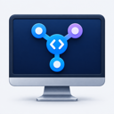
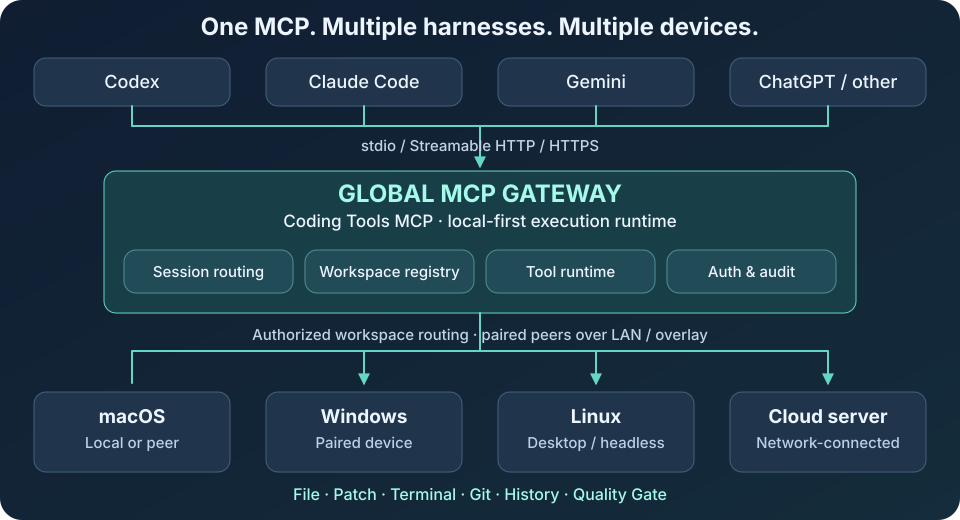
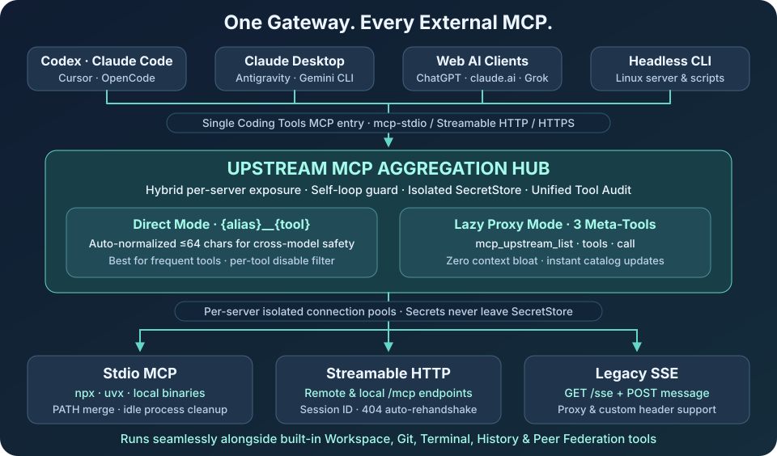
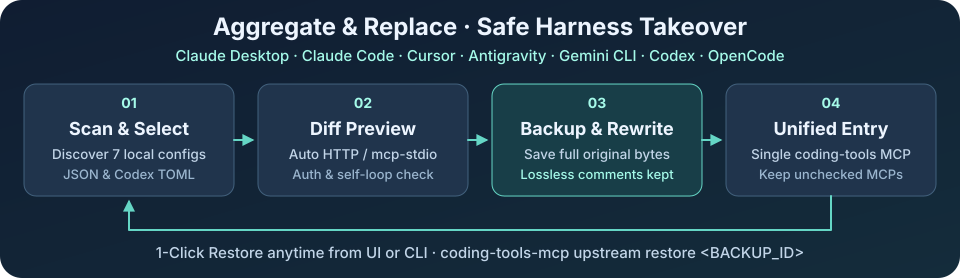
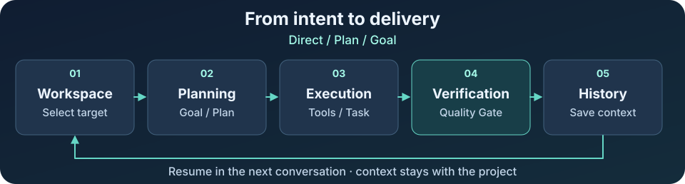

<p align="center">
  
</p>

<h1 align="center">Coding Tools MCP</h1>

<p align="center">
  一次连接，让任意兼容 MCP 的 AI Harness 开发你的多台设备，并统一聚合所有外部 MCP。
</p>

<p align="center">
  <a href="https://github.com/lengsukq/coding-tools-mcp/releases/latest"></a>
  
  
  
  <a href="https://www.apache.org/licenses/LICENSE-2.0"></a>
</p>

<p align="center">
  <a href="README.md">中文</a> · <a href="README.en.md">English</a> · <a href="https://github.com/lengsukq/coding-tools-mcp/releases/latest">下载最新版</a>
</p>

Coding Tools MCP 是一个 **本地优先、跨设备、与模型及 Agent Harness 解耦的 AI 开发运行时**。连接一次 MCP，即可让兼容的 AI 客户端访问本机、其他电脑和云服务器上的授权工作区，并持续完成真实软件工程任务。

<p align="center">
  
</p>

**一个 MCP 入口 · 多个 Harness · 多台设备 · 外部 MCP 聚合与接管 · 持久化项目上下文**

[快速开始](#五分钟开始使用) · [MCP 聚合与一键接管](#一个入口聚合所有外部-mcp支持一键接管) · [Linux 无头部署](docs/linux-headless.md) · [Harness 接入指南](docs/harness-connectors.md) · [网页 AI 接入指南](docs/web-chat-connectors.md) · [架构文档](docs/project-context/architecture.md)

## 核心能力

| 功能 | 你能做什么 |
| --- | --- |
| **任意兼容 MCP 的 Harness** | 通过原生 Rust `mcp-stdio` 或 Streamable HTTP 接入 Codex、Claude Code、Gemini 等兼容客户端；网页 AI 可走 HTTPS MCP。 |
| **跨设备联邦** | 一个 Global MCP 入口发现配对设备，跨 macOS、Windows、Linux 和已组网的云服务器读取代码、修改文件、运行命令及测试。 |
| **MCP 聚合与一键接管** | 统一挂载第三方 Stdio / Streamable HTTP / Legacy SSE MCP；支持直出（`{alias}__{tool}`）与 3 元工具懒加载代理混排、单工具过滤、凭据隔离存储、7 类客户端扫描及带自动备份还原的「聚合并替换」。 |
| **多工作区与多会话** | 一次连接管理多个项目；每个 MCP Session 独立选择 Workspace，也可通过 `workspace_id` 显式指定目标。 |
| **Agent 执行框架** | Direct / Plan / Goal 三种模式，统一管理目标、计划、任务、执行证据与人工验收。 |
| **持久化项目记忆** | History 保存在项目目录，支持摘要恢复、历史搜索及分页读取；切换 AI 客户端也能继续开发。 |
| **真实工程验证** | 文件、Patch、Terminal、Git、Skills 与 Quality Gate 共用工具内核，支持代码审查与执行记录。 |
| **原生 Computer Use** | macOS 按需屏幕观察、受控键鼠输入、跨设备转发、高风险操作确认和紧急暂停。 |
| **Linux Headless** | 无 GTK 桌面依赖的 x64 / ARM64 独立二进制，支持 CLI、一键安装、systemd 常驻和仓库自动发现。 |
| **连接与安全治理** | OAuth、PKCE、DCR、Bearer、HMAC 配对，FRP / Cloudflare 隧道，以及工具审计、健康检查与全局 Dashboard。 |

## 一次连接，开发所有设备上的项目

本地 Harness 可以直接连接 `http://127.0.0.1:<port>/mcp`，或通过原生 `mcp-stdio` 桥接，无需 Node.js 或公网隧道。远程 AI 客户端可使用 HTTPS MCP。配对设备通过局域网或 EasyTier / Tailscale 等组网连接，不需要为每台设备单独配置 AI 客户端。

### 日常使用场景：一台主力电脑，整个开发环境

假设你有一台日常办公的 MacBook、一台家里常驻的 Mac mini、一台 Windows 测试机，以及一台 Linux 云服务器。

你只需要在 MacBook 上配置一次自己喜欢的 AI Harness（例如 Codex、Claude Code 或 Gemini CLI），连接 Coding Tools MCP。其他设备只需运行 Coding Tools MCP（Linux 可使用 Headless 模式）、完成配对并共享项目，无需重复安装和配置 Harness、模型 API Key 或 MCP 客户端。

| 设备 | 日常用途 |
| --- | --- |
| MacBook · 主力机 | 运行 Harness，统一发出开发指令 |
| Mac mini · 家庭开发机 | 修改项目、构建 macOS / iOS 应用 |
| Windows · 测试机 | 编译 Windows 应用、运行平台测试 |
| Linux · 云服务器 | 开发后端、查看日志、维护服务 |

在同一个 AI 对话中，你可以说：“先修改 Mac mini 上的项目，再去 Windows 上运行测试，最后检查 Linux 服务器上的服务日志。” AI 通过 MCP 选择对应设备的 Workspace，文件和命令操作在目标设备上执行。

**只配置一次 Harness，新增设备只需配对。换模型或换 Harness，也无需重新配置每一台执行设备。** 多个兼容客户端也可连接同一网关，各自保持工作区上下文。

> 前提：客户端支持相应 MCP 传输和认证方式，设备在线且已授权共享 Workspace。只有经由 MCP 的工具调用才会路由到目标设备；Harness 自带的 Shell、编辑器等工具不会自动变成远程工具。不同客户端的实际兼容性可能有所差异。

## 一个入口，聚合所有外部 MCP（支持一键接管）

不想在 Codex、Claude Code、Cursor、Claude Desktop、Gemini CLI、OpenCode 或网页 AI 里反复维护同一套 `mcpServers`？通过内置的 **MCP 聚合中心（Upstream MCP Hub）**，只需将第三方 MCP 统一挂载到 Coding Tools MCP，所有上层客户端连这一个入口即可调用全部工具。

<p align="center">
  
</p>

- **全协议接入**：原生支持 **Stdio**（`npx` / `uvx` / 本地可执行文件，带全局 `PATH` 合并与空闲进程回收）、**Streamable HTTP**（自动维护 Session 与 404 重握手）及 **Legacy SSE**，每个上游独立连接池，单点故障互不阻塞。
- **直出 + 代理混合编排（按服务切换）**：
  - **直出模式（`direct`）**：上游工具自动带 `{alias}__{tool}` 前缀并归一化为跨模型安全的 ≤64 字符名称，高频工具一步调用；
  - **懒加载代理模式（`proxy`）**：仅暴露 `mcp_upstream_list`、`mcp_upstream_tools`、`mcp_upstream_call` 三个固定元工具，避免撑爆上下文或触达网页端工具上限，配置更新即时生效。
- **安全与可观测**：支持单工具细粒度禁用、敏感环境变量 / Header / Bearer Token 隔离写入 `SecretStore`（永不回显明文）、防自环拦截，以及统一写入工具审计（标注 `upstream:<alias>`）。

### 聚合并替换：一键接管 7 类本地 Harness 配置

在桌面端 **应用设置 → 连接与多机互联 → MCP 聚合中心 → 扫描 / JSON 导入**（或命令行）扫描本机已有 MCP 配置时，可勾选 **「聚合并替换原客户端配置」**，安全完成迁移与收口：

<p align="center">
  
</p>

| 已支持扫描与接管的 Harness | 配置文件格式 | 默认接管方式（`auto`，可切换 `http` / `stdio`） |
| --- | --- | --- |
| **Codex** | `~/.codex/config.toml`（逐段无损改写，保留用户注释） | 本机免鉴权时优先 HTTP，否则自动降级 `mcp-stdio` |
| **Cursor** / **Claude Code** / **OpenCode** | 各自 JSON 配置（自动适配 `mcpServers` / `mcp`） | 本机免鉴权时优先 HTTP，否则自动降级 `mcp-stdio` |
| **Claude Desktop** / **Antigravity** / **Gemini CLI** | 各自 JSON `mcpServers` 配置 | 优先原生 `mcp-stdio` 桥接 |

- **透明预览与无损改写**：执行前展示逐文件 Diff 与精确配置片段；仅移除本次勾选导入的条目，完整保留同文件中的其他设置与未勾选 MCP；若原配置已指向本机 Coding Tools MCP 自动去重。
- **自动全量备份与一键还原**：写入前自动保存原文件完整字节至 `data/harness-backups/`（最多保留 40 份），桌面端底部卡片或 CLI 均可随时一键还原。

```bash
# 扫描本机 7 类客户端配置；加 --yes 导入，加 --replace 自动备份并接管为统一入口
coding-tools-mcp upstream import --scan --yes --replace --connect-mode auto

# 查看接管备份并随时一键还原指定配置文件
coding-tools-mcp upstream backups
coding-tools-mcp upstream restore <BACKUP_ID>

# Linux 无头服务器或脚本化管理单个上游服务
coding-tools-mcp upstream add github --http https://api.githubcopilot.com/mcp/ --bearer "$TOKEN" --mode proxy
coding-tools-mcp upstream list
```

## 从需求到交付，跨会话持续开发

<p align="center">
  
</p>

- **Direct**：快速修改、小型任务；**Plan**：先规划再执行；**Goal**：目标驱动、验收约束与长期开发。
- 使用 Execution Ledger、Quality Gate、Git Diff / Review 和工具审计检查结果，而不只是相信 AI 的完成声明。
- 使用项目内 History 保存进度和决策，下一次对话按需恢复上下文。

项目运行环境与上层模型、Harness 分离；任务推理和调度仍由接入的 AI 客户端负责。本项目不提供独立模型推理或自动分布式多 Agent 调度。

## 30 秒看懂怎么用

1. 安装桌面端或 Linux 无头服务，添加项目目录。
2. 启动 Global MCP；如需跨设备开发，配对并共享目标工作区。
3. 选择本地 stdio / HTTP 或公网 HTTPS MCP 接入 AI 客户端。
4. 调用 `workspace_list`，用 `workspace_select` 或显式 `workspace_id` 选择项目，然后开始开发。

[完整安装步骤](#五分钟开始使用) · [ChatGPT 配置](#mcp-connector) · [Linux 服务器部署](docs/linux-headless.md) · [详细功能与技术架构](docs/project-context.md)

## 五分钟开始使用

### 1. 安装客户端（桌面端或 Linux 无头服务器）

打开 [Releases](https://github.com/lengsukq/coding-tools-mcp/releases/latest) 并下载对应安装包，或直接在 Linux 服务器上使用一键安装脚本：

| 系统与形态 | 安装方式 / 安装包 |
| --- | --- |
| Windows 10/11 x64 | `Coding.Tools.MCP_*_x64-setup.exe` |
| macOS（Intel + Apple Silicon） | `Coding.Tools.MCP_*_universal.dmg` |
| Linux 桌面端（x64） | `*.deb` / `*.AppImage` |
| Linux 无头服务器（x64 / ARM64，零 GTK 依赖） | `coding-tools-mcp-v*-linux-*-headless.tar.gz` 或下方一键脚本 |

macOS 安装包目前未签名。如果系统阻止首次打开，请在“系统设置 → 隐私与安全性”中确认打开。

#### Linux 服务器一键安装（无头模式）

```bash
# 1) 一键安装无头二进制（自动识别 x86_64 / aarch64）
curl -fsSL https://raw.githubusercontent.com/lengsukq/coding-tools-mcp/main/scripts/install-linux.sh | bash

# 2) 一键安装 + systemd 开机常驻 + 开启跨设备联邦 + 自动纳管 ~/code 下全部 .git 仓库 + 打印 6 位配对码
curl -fsSL https://raw.githubusercontent.com/lengsukq/coding-tools-mcp/main/scripts/install-linux.sh | \
  bash -s -- --service --lan --auto-root ~/code --pair-pin
```

- 以 `sudo bash -s -- --service ...` 执行时自动安装 **root 系统级 systemd**（`/etc/systemd/system/coding-tools-mcp.service`）；普通用户自动安装 **`systemd --user`**。
- 国内网络可附加 `--mirror https://gh-proxy.com/`；如需从最新源码直接编译可附加 `--from-source`。
- 完整 CLI 子命令、systemd 日志、跨网段组网与排障说明见：[Linux 无头模式与服务器部署指南](docs/linux-headless.md)。

### 2. 添加项目工作区

1. 点击左侧的“添加工作区”。
2. 选择项目根目录。
3. 设置工作区名称并保存；工作区会长期保留在左侧列表中。

### 3. 配置公网隧道或本地连接

- **同一台 Mac / 本机客户端（推荐优先使用）**：打开 **「应用设置 → MCP 连接」**，无需开启公网隧道即可使用本地回环地址（`http://127.0.0.1:<端口>/mcp`），或直接在 **「Gemini App · MCP 连接 → Local MCP」** 点击「生成凭据并复制」，通过内置原生 `mcp-stdio` 桥接直连。
- **跨设备局域网协同**：在 **「应用设置 → MCP 连接 → 局域网多设备配对」** 中扫描或探测同局域网设备，通过 6 位配对码安全握手，即可在一个 MCP 入口中使用 `{device_id}:{workspace_id}` 跨机操作 macOS / Windows 上的项目。
- **公网远程访问（ChatGPT / Gemini 网页版 / claude.ai / Grok）**：在 **「应用设置 → MCP 连接」** 配置公网入口：
  - **零门槛推荐：Cloudflare Quick Tunnel**。选择 Cloudflare 快速模式，无需账号即可生成 `https://<随机>.trycloudflare.com` 公网地址，并支持在面板中一键强制重启隧道；长期使用建议 FRP 固定子域名或外部反向代理。
  - 在 **「应用设置 → 网络与工具」** 中安装或识别 `frpc` / `cloudflared`。
  - 在 **「应用设置 → MCP 连接 → FRP 服务器配置」** 中保存服务器、端口和 Token，再回到 Global MCP 连接选择 FRP 并填写唯一子域名。

如果还没有可用的 FRPS 服务端，可以参考：[FRPS 服务端安装教程（微信公众号）](https://mp.weixin.qq.com/s/kmpQhHsvmHlaLfj4rw3A0Q)。安装完成后，把服务端地址、端口和 Token 填入客户端的“FRP 配置”即可。

### 4. 启动 MCP

在 Dashboard 或“应用设置 → MCP 连接”点击“启动 Global MCP”。客户端会显示：

- 唯一本地 MCP 地址，例如 `http://127.0.0.1:28765/mcp`；
- 公网 HTTPS MCP 地址；
- ChatGPT / Gemini 连接所需的认证与桥接信息；
- 实时日志和健康检查结果（支持分别检查本地与公网端点、OAuth 元数据和 MCP 受保护资源，并在桌面端直接查看最近的 MCP 请求日志，确认工具列表、历史与检查点调用是否真正到达服务端）。

### 5. 连接 AI 客户端

除 ChatGPT 外，claude.ai、Grok、Gemini 等支持远程 MCP Connector 的网页客户端都可以接入同一工作区：[网页 Chat 客户端接入矩阵](docs/web-chat-connectors.md) 提供逐客户端配置、认证选择和排查表。

支持 MCP 的客户端使用界面中的公网 MCP URL。OAuth 当前支持 Authorization Code + PKCE S256、Dynamic Client Registration（`/register`）和 Refresh Token。支持动态注册的客户端可以直接读取服务端 metadata 并注册自己的 Client；不支持 DCR 的旧客户端仍可继续使用桌面端配置的静态 Client ID / Secret。

首次连接建议先明确选择 Workspace；历史初始化不再是必需步骤：

```text
workspace_list
workspace_select(workspace_id=...)
server_info
git_status
```

这样 Agent 不需要依赖聊天上下文猜测当前项目。如果客户端不能稳定保留 MCP Session，单次跨 Workspace 操作可以改用 `workspace_invoke(workspace_id=..., tool=..., arguments=...)`，而不是反复切换或猜测目录。需要显式创建或恢复历史目标时，再使用 History 能力。

## ChatGPT 接入方式

### MCP Connector

配置前请先确认：

1. Global MCP 服务和公网隧道均处于运行状态。
2. “健康检查”中的公网 MCP 检查通过；如果使用 OAuth，再确认 OAuth 受保护资源和授权元数据检查通过。
3. 从桌面端“GPT 配置”卡片复制“公网 MCP 地址”。使用 OAuth 时需要授权口令；只有客户端不支持动态注册时才需要额外填写静态 Client ID / Secret。

> ChatGPT 必须使用公网 HTTPS `/mcp` 地址，不能使用 `http://127.0.0.1:28766/mcp` 之类的本地地址。ChatGPT 的菜单名称可能随版本和语言设置略有变化。

#### 1. 开启 ChatGPT 开发人员模式

打开 ChatGPT 设置，进入“账户安全与登录”，开启“开发人员模式”。该开关允许添加未经验证的 MCP 连接器。


*开发人员模式具有较高权限，只应连接你自己部署或明确可信的 MCP 服务。*

#### 2. 创建 MCP 插件

在 ChatGPT 左侧进入“插件”，点击右上角的 `+` 新建插件，然后选择 MCP（测试版）并填写：

| ChatGPT 字段 | 填写内容 |
| --- | --- |
| 名称 | 自定义一个容易识别的名称，例如 `Coding Tools MCP` |
| 描述 | 简要说明它连接的项目或用途 |
| 连接 | 粘贴桌面端“GPT 配置”中的公网 MCP 地址，URL 应以 `/mcp` 结尾 |
| 身份验证 | 与桌面端保持一致；截图以 OAuth 为例 |


使用 OAuth 时，优先让支持 Dynamic Client Registration 的客户端根据 metadata 自动注册；若当前客户端只支持静态 OAuth，则继续填写桌面端提供的 Client ID 和 Client Secret。保存或连接后会进入授权页面，输入桌面端“GPT 配置”卡片中的授权口令完成授权。

> Client Secret、授权口令和 Bearer Token 都属于敏感信息，不要粘贴到对话、Issue 或公开截图中。若桌面端使用 Bearer 或不启用认证，请在 ChatGPT 中选择当前界面提供的对应认证方式。

#### 3. 验证连接

创建一个启用了该插件的新对话，并发送：

```text
请使用 Coding Tools MCP 先调用 workspace_list，选择 coding-tools-mcp 工作区，
然后调用 server_info 和 git_status，告诉我当前 Workspace、MCP 状态和 Git 状态。
```

如果能够返回当前项目的信息，说明“桌面端 → 公网隧道 → OAuth → ChatGPT → MCP 工具”链路已经打通。当前会话默认允许记录检查点；旧会话是否注入由工作区的“历史上下文”面板多选控制。

如果 ChatGPT 仍显示旧的工具列表，请断开并重新连接插件，或创建一个新对话后再次验证。

#### 常见问题

| 现象 | 优先检查 |
| --- | --- |
| ChatGPT 无法连接 | 是否使用公网 HTTPS `/mcp` 地址，而不是 `127.0.0.1`；桌面端公网 MCP 健康检查是否通过 |
| OAuth 授权失败 | Client ID、Client Secret 和授权口令是否来自同一个工作区；OAuth 元数据检查是否通过 |
| 看不到新增工具 | 断开并重新连接插件，然后创建一个新对话 |
| 工具调用失败 | 打开桌面端“日志”和“健康检查”，确认请求是否到达 MCP 服务 |

## 为什么需要它

- **面向真实开发**：文件、命令、Git、测试和长时间运行的进程都在同一个 Workspace 中。
- **跨会话持续开发**：新对话先获得有界的当前状态，需要精确旧上下文时按关键词定位并读取原始档案，无需反复向 AI 解释项目背景和当前进度。
- **进度可追溯**：每轮任务完成后可保存结构化检查点，决策、修改、测试结果和下一步都留在项目目录中。
- **多工作区管理**：一个 Global MCP 连接管理多个本地项目，Chat Session 分别选择自己的 Workspace，不需要为每个项目重复配置 MCP 和公网入口。
- **连接 ChatGPT 更直接**：内置 Streamable HTTP、OAuth、Bearer Token、FRP 和 Cloudflare 隧道。
- **默认工具面保持简单**：稳定的核心工具默认可用，高级 Harness 能力按需开启。

## 让项目记住每次对话

普通聊天记录适合回看交流内容，但不适合作为长期开发交接。Coding Tools MCP 将会话进度写入当前项目的 `docs/history-session/`，让上下文跟随项目，而不是困在某一个聊天窗口里。

历史上下文面板提供当前会话记录开关、历史会话多选、预览和清除选择。应用选择后会刷新 MCP 上下文，只注入会话索引、最近检查点、关键文件和精选片段；每个会话最多 3 条片段、每条最多 512 字节。完整 Markdown 历史仍保存在 `docs/history-session/`，需要时再用搜索和分页读取工具恢复。

默认 `compact` profile 通过 Stable Tool API v2 的 `history_manage` 聚合入口访问历史能力；`core` / `advanced` 兼容 profile 仍保留以下五个旧工具名：

| 工具 | 作用 |
| --- | --- |
| `history_session_bootstrap` | 兼容或手动初始化/恢复项目会话；compact 模式只返回有界索引，不返回全量历史 |
| `history_session_checkpoint` | 当前会话默认按需追加结构化进度；可省略 `session_key` 和 `expected_path`，服务端会懒初始化目标 |
| `history_session_validate` | 检查历史编号、文件和会话映射；必要时重建派生索引，不删除已有历史 |
| `history_session_search` | 按确定性关键词搜索长期 Markdown 档案，返回有界的命中位置和短片段 |
| `history_session_read` | 按编号或搜索结果位置，无损、UTF-8 安全地分页读取一份原始 Markdown 档案；默认每页 `16 KiB`，最多 `64 KiB`，根据 `next_cursor` 继续读取 |

典型效果：

```text
对话 1：分析项目 → 修改代码 → 运行测试 → 保存检查点
                                      ↓
对话 2：读取有界当前状态 → 搜索并精读需要的旧档案 → 从上次进度继续 → 保存新检查点
```

历史档案使用可读的 Markdown 格式，可以随项目备份或纳入 Git，也方便开发者直接审阅和修订。`memory/state.json` 是有界当前状态投影，`memory/manifest.json` 只保存位置、哈希与关键词，不复制正文；Markdown 才是长期、无损的事实来源。若手动调用 bootstrap，首次输入可作为 `initial_user_input` 传入；每轮检查点使用 `raw_user_input`，服务端无法读取未传入的远程聊天文本。检查点采用幂等追加，同一 `turn_id` 内容变化时保留 revision 与 supersedes 证据，并要求返回成功且会话目标一致后才确认保存成功。

> 历史持久化由 AI 调用 MCP 工具完成，并非桌面端在后台录制聊天内容。若客户端未触发工具调用，服务端无法凭空感知新的对话或任务进度。

## Agent 可以做什么

默认 `compact` profile 提供一组稳定、可组合的开发工具；`core` 和 `advanced` 作为 legacy 兼容 profile 保留：

| 类别 | 主要工具 |
| --- | --- |
| 文件读取 | `read_file`、`list_dir`、`list_files`、`search_text`、`grep_text`、`view_image` |
| 文件修改 | `apply_patch` |
| 命令执行 | `exec_command`、`write_stdin`、`read_output`、`kill_session` |
| Git | `git_status`、`git_diff`、`git_log`、`git_show`、`git_blame` |
| Workspace 路由 | `workspace_list`、`workspace_current`、`workspace_select`、`workspace_invoke` |
| 运行时 | `server_info` |
| 状态管理 | `history_manage`、`planning_manage`；Stable Tool API v2 继续提供聚合式生命周期接口 |
| 上游 MCP 聚合 | 直出 `{alias}__{tool}` 或懒加载代理元工具 `mcp_upstream_list`、`mcp_upstream_tools`、`mcp_upstream_call` |

聚合工具通过 `action` 参数完成生命周期操作，例如 `history_manage(action=search)` 或 `planning_manage(action=update_plan)`。这样新增生命周期行为时不需要持续扩大顶层 MCP Tool Schema；兼容 profile 仍可保留旧工具名。

长运行命令现在归属于 Workspace Runtime，而不是某一次 MCP transport 连接。`exec_command` 返回稳定 `command_id`，重新连接或从同一 Workspace 的另一运行入口仍可继续 `read_output` / `write_stdin` / `kill_session`；旧 `session_id` 参数继续兼容。stdout/stderr 在内存中保留固定预算的 Head + Tail 作为低延迟预览，同时完整原始输出会写入应用缓存目录；因此普通同步命令结束并从 SessionStore 回收后，稳定 `output_ref` 仍可分页读取中间内容。`read_output` 还支持 `query` / `regex` / `case_sensitive` 的受限日志搜索，完整日志不直接塞回模型上下文。

`exec_command(action=quality_gate)` 复用同一 Tool Surface 自动发现项目已有的 lint/check/typecheck/test/build/format 检查，支持 `dry_run`、`checks` 过滤和 `stop_on_failure`。每个派生检查都会重新经过现有命令策略，并返回紧凑的 `PASS/WARN/FAIL`、耗时、关键错误/警告计数及独立 `output_ref`；不会自动安装依赖、deploy 或 publish。

`server_info` 的 `runtime` 元数据包含 `runtime_id`、启动时间、应用版本、构建身份以及当前 Tool Profile 的 `tool_schema_version` / `tool_schema_hash`。客户端可以回传 `known_schema_hash`，在工具 Schema 已变化时得到 `schema_changed` / `reconnect_recommended`，避免继续误用旧 Runtime 或旧工具定义。

典型开发过程：

```text
打开 Workspace
  → 理解项目和 Git 状态
  → 搜索并读取代码
  → 事务化应用 Patch
  → 运行命令和测试
  → 检查 diff 并提交
```

高级 profile 还保留项目状态、操作记录等 Harness 能力，但普通文件修改和命令执行不要求先创建 Task。

## 权限与恢复模型

项目采用 Workspace-first 权限模型：

- Workspace 内普通文件可以读取、创建、修改、删除和执行。
- Workspace 外允许完整只读：`read_file`、`list_dir`、`list_files`、`search_text`、`view_image`。
- Workspace 外写入、删除和执行会被阻止。
- `.git/**` 永久禁止写入。高风险文件（包括 `.github/**`、`.gitignore`、`Cargo.toml` / `Cargo.lock`、`package.json` / lockfile、`tauri.conf.json`、`vite.config.*`、`pyproject.toml`、README/LICENSE）默认禁止 Patch 写入，可在单个 Workspace 的“设置 → 仓库保护 → 允许 AI 修改高风险文件”中开启。即使开启，删除高风险文件仍需显式确认，命令级危险操作继续受原有策略保护。
- Patch 在单次操作内进行预检和失败恢复；长期恢复统一使用 Git，不创建全量 Workspace Snapshot。

> Windows 子进程目前仍是 `policy_only` 执行边界，返回中的 `sandbox_enforced: false` 是真实状态。静态命令策略不能等同于完整的操作系统文件系统沙箱。

## 本地开发

环境要求：Node.js 20+、Rust stable，以及当前系统的 [Tauri 2 prerequisites](https://v2.tauri.app/start/prerequisites/)。

```bash
npm install
npm run desktop
```

常用验证命令：

```bash
npm run test:workspace
npm run test:release
npm run check
npm run build
cd src-tauri && cargo test
cd src-tauri && cargo clippy --all-targets -- -D warnings
```

`npm run test:workspace` 专门运行真实 Workspace 生命周期回归，包括旧/损坏 Planning、Plan/Goal 门禁、History/Harness 内部状态和真实外部修改检测。`npm run test:release` 是本地发布前的统一 dogfood 入口，会串联版本检查、前端检查/构建和全部 Rust test targets。

Windows 也可以双击 `dev-desktop.cmd`。不要只用 `npm run dev` 验证桌面应用，它只启动 Vite，不会启动 Tauri 外壳。

## 项目结构

| 路径 | 作用 |
| --- | --- |
| `src-tauri/src/cli/` & `src-tauri/src/bin/coding-tools-mcp.rs` | 零 GTK 无头守护进程 `serve`、终端联邦配对、工作区自动发现与 `systemd` 服务管理 CLI |
| `scripts/install-linux.sh` | Linux 无头版一键安装、升级、systemd 集成与卸载脚本 |
| `src-tauri/src/tools/` | 统一 Tool 内核、Schema、Policy、文件/Git/Exec/History/Planning/Skill |
| `src-tauri/src/mcp/` | Global MCP Streamable HTTP 服务、OAuth/Review 路由与 `mcp-stdio` 无头桥接 |
| `src-tauri/src/upstream_mcp/` & `upstream_mcp.rs` | 全局 MCP 聚合引擎（Stdio / Streamable HTTP / Legacy SSE 客户端、直出/代理混合网关、客户端扫描与「聚合并替换」无损接管/备份还原） |
| `src-tauri/src/lan_peer/` & `lan_peer.rs` | 跨平台局域网设备发现、6 位配对码握手、HMAC 对等 RPC 与公网隔离 |
| `src-tauri/src/computer/` & `computer.rs` | macOS 原生 Computer Use（ScreenCaptureKit 截图观察、受控输入与权限门控） |
| `src-tauri/src/tool_audit/` & `tool_audit.rs` | 工具调用隐私安全审计、日期分区 JSONL 存储与过期轮转 |
| `src-tauri/src/review/` & `review.rs` | 工作区/会话/跨设备变更快照生成与 Unified/Split Diff 服务 |
| `src-tauri/src/tunnel/` | FRP / Cloudflare 隧道下载、配置与进程监督 |
| `src-tauri/tests/fixtures/` | 当前 Rust 集成测试使用的隔离 fixture |
| `src/` | Vue 3 + Vue Router + Tailwind CSS 4 桌面界面与多主题设计系统 |

## 致谢
感谢 [Linux.do](https://linux.do/) 社区对项目推广与反馈的支持。

## License

[Apache-2.0](https://www.apache.org/licenses/LICENSE-2.0)
