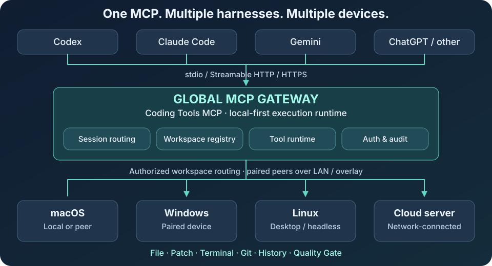
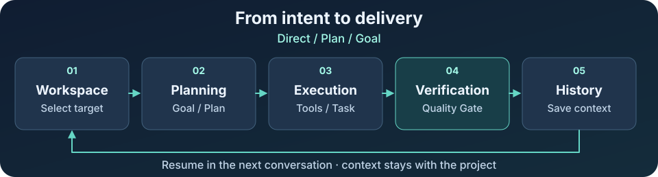

# 通用 Agent Harness 与本地 MCP 接入指南

Coding Tools MCP 将上层 AI 客户端与真实执行环境分离。一个兼容 MCP 的 Harness 可以通过单一入口访问本机和已配对设备上的授权工作区，不需要为每个项目或每台设备创建独立连接。



## 1. 选择连接方式

| 使用场景 | 传输 | 配置 |
| --- | --- | --- |
| 本机 CLI / 桌面 Harness | stdio | 启动原生 `coding-tools-mcp mcp-stdio` 桥接进程 |
| 支持本地 HTTP 的 Harness | Streamable HTTP | `http://127.0.0.1:<port>/mcp` |
| 远程或网页 AI | HTTPS / Streamable HTTP | Global MCP 公网地址，OAuth 或 Bearer |
| 跨设备开发 | 上述任一入口 | 入口与目标设备完成联邦配对并授权共享 Workspace |

Codex、Claude Code、Gemini CLI、OpenCode 等属于可按其 MCP 能力接入的候选客户端；具体配置语法、认证支持和工具兼容性以各客户端版本为准，并不表示每个版本均已通过端到端测试。

## 2. 本机 stdio

1. 启动 Coding Tools MCP 的 Global MCP 服务。
2. 在桌面端「Gemini App · MCP 连接」的 Local MCP 面板生成凭据并复制命令（OAuth 推荐）。
3. 在支持 stdio 的 Harness 中注册服务器进程。以下为通用配置结构示意，客户端实际字段可能不同：

```json
{
  "mcpServers": {
    "coding-tools": {
      "command": "/absolute/path/to/coding-tools-mcp",
      "args": ["mcp-stdio", "http://127.0.0.1:28765/mcp"]
    }
  }
}
```

使用实际安装路径、端口和面板生成的凭据，不要将 Token 或 Secret 写进仓库。桥接进程仅接受带显式端口的回环 HTTP `/mcp` 地址，无需 Node.js 或公网隧道；Global MCP 服务必须保持运行。Bearer 模式仅在启用本机回环免授权时支持面板自动准备本地桥接；否则使用兼容的认证方式。

## 3. 本机 HTTP 与公网 HTTPS

支持 Streamable HTTP 的本地客户端可直接填入回环地址，按服务端认证策略配置凭据。运行在云端的 AI 无法访问用户电脑的 localhost；此时应使用 Global MCP 的公网 HTTPS 地址和适配的 OAuth / Bearer 认证。详情见 [网页客户端接入](./web-chat-connectors.md)。

## 4. 跨设备工作区选择

先在目标设备注册项目，启用联邦并完成配对。跨网段可使用可信 overlay 网络；服务器部署见 [Linux Headless 指南](./linux-headless.md)。

建议接入后按以下顺序验证：

1. `workspace_list`：发现本机和对等节点的 Workspace。
2. `device_list`（若客户端工具目录提供）：查看设备状态。
3. 复制目标工作区返回的完整 ID；远程 ID 为 `{device_id}:{workspace_id}`。
4. 在 `server_info`、`git_status` 等项目工具调用中显式传入该 `workspace_id`，验证目标设备和仓库。
5. 支持持久 MCP Session 的客户端也可以先 `workspace_select`，再调用项目工具。

如果设备离线、共享权限不足或目标不明确，应停止对应操作并检查路由，不应默默改为本机执行。

## 5. 给 Harness 的使用指引

```text
使用 Coding Tools MCP 进行项目开发。
先调用 workspace_list，确认目标设备与 Workspace。
每次项目工具调用显式传入目标 workspace_id。
远程文件、命令和 Git 操作使用 MCP 工具，不使用本机 Shell 代替。
复杂任务维护 Goal / Plan，执行后运行 Quality Gate 并检查 Diff。
在完成或交接时保存必要的 History。
```



## 6. 聚合外部 MCP（Upstream MCP Hub）

无需在每个上层 AI 客户端中重复维护一套 `mcpServers`：在桌面端「应用设置 → 连接与多机互联 → MCP 聚合中心」或 Linux CLI（`coding-tools-mcp upstream add / import / test`）挂载其他 Stdio / Streamable HTTP / Legacy SSE MCP 后，所有连入本入口的客户端均可统一使用：

- **直出模式（`direct`）**：上游工具自动带 `{alias}__{tool}` 前缀并归一化为跨模型兼容的 ≤64 字符名称直接进入 `tools/list`，适合少量高频工具；
- **懒加载代理模式（`proxy`）**：不平铺上游工具，仅暴露 `mcp_upstream_list`、`mcp_upstream_tools`、`mcp_upstream_call` 三个固定元工具，避免撑爆上下文或触达网页端工具数量上限，且配置变更即时生效；
- 两种模式均支持按单工具细粒度禁用，并统一记录到 Tool Audit（标注 `upstream:<alias>`）与隔离存储敏感凭据。

## 7. 能力边界与安全

- 本项目提供 MCP 执行基础设施，不替代上层 Harness 的模型推理或 Agent Loop，也不自动接管其内置编辑器与 Shell。
- 请求级 Workspace 路由可避免会话切换串线，但不等同于多 Agent 并发写入隔离；同一仓库的并行修改仍需要协调。
- 联邦只访问已配对、在线并授权的工作区；并非任意公网机器或自动多 Agent 调度平台。
- Computer Use 目前是 macOS 原生能力，需单独开启和授权。
- 本地免认证仅适用于可信回环环境；公网入口应启用认证。优先使用最小权限账号及工作区策略。

返回 [README](../README.md) · [架构设计](./project-context/architecture.md)
