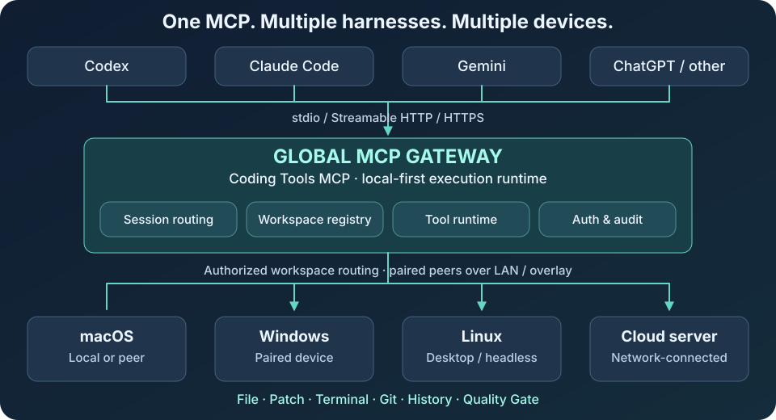

# Coding Tools MCP - 项目上下文

> 本目录记录当前代码事实，供开发者和 Agent 快速恢复架构上下文。

## 项目概览

| 属性 | 当前值 |
| --- | --- |
| 项目名称 | Coding Tools MCP |
| 版本 | `0.3.10` |
| 桌面端 | Tauri 2 |
| 前端 | Vue 3 + Vue Router 4 + Tailwind CSS 4 + TypeScript |
| 后端 | Rust 2021 + Tokio + Axum |
| 类型 | Local-first Cross-device AI Development Runtime + Desktop / Headless |
| 核心定位 | 让兼容 MCP 的模型与 Harness 共享本机、对等设备和云服务器上的授权 Workspace、执行工具及持久上下文 |

上层 AI 客户端负责推理、工具选择与任务调度；本项目提供统一的执行、路由、状态与审计能力，不内置模型推理或自主多 Agent 调度。

## 当前核心能力

- 单一 Global MCP 连接管理多个隔离 Workspace，并支持跨 macOS / Windows / Linux 局域网对等配对与单跳联邦路由（`{device_id}:{workspace_id}` 复合作用域与 `device_list` 设备发现）；
- **全局 MCP 聚合中心（Upstream MCP Hub）**：支持将外部 Stdio / Streamable HTTP / Legacy SSE MCP 服务聚合至同一入口，单上游可切换「直出前缀（`{alias}__{tool}`）」或「懒加载代理（`mcp_upstream_list` / `mcp_upstream_tools` / `mcp_upstream_call`）」，提供单工具过滤、敏感凭据隔离存储、本机主流客户端一键扫描与 `mcpServers` JSON 导入，以及 `coding-tools-mcp upstream ...` 无头 CLI；
- 零 GTK 依赖 Linux 无头二进制目标 `coding-tools-mcp`（`--no-default-features`），内置 `serve`/`status`/`reload`/`stop`/`workspace`/`upstream`/`lan`/`config`/`service` CLI、父目录 `.git` 自动发现、`0600` Unix Socket 本地控制总线、用户级/root 系统级 `systemd` 服务管理及一键安装脚本 `scripts/install-linux.sh`；
- request-scoped `workspace_id` 路由，并兼容持久 MCP session 的 `workspace_select`；
- MCP Streamable HTTP 与本机回环 `mcp-stdio` 无头桥接（供桌面端 Gemini / Claude 等本地 MCP 宿主直连）；
- Bearer / OAuth、PKCE S256、Dynamic Client Registration、Refresh Token；
- macOS 原生 Computer Use（ScreenCaptureKit 截图观察与目标应用受控输入，含高风险动作单次审批、客户端审计及局域网跨设备 `device_id` 消歧转发）；
- 文件、Patch、命令、Git、图片与 Skill 工具；
- Stable Tool API v2 聚合管理入口；
- Direct / Plan / Goal 模式与人工验收；
- Planning / Harness Task / History 通过 Execution Ledger 收口执行状态；
- 项目内 `docs/history-session/` 无损历史；
- FRP / Cloudflare 与 Global Gateway（含局域网对等节点变更审查快照 `/review/peer/{device_id}/{id}` 单隧道穿透）；
- 应用级共享密钥存储、工具调用审计日志（JSONL 日期分区、自动过期轮转与跨设备双向审计记录）、运行日志、健康检查与 usage 统计。

## 文档导航

- [Linux 无头模式与服务器部署指南](./linux-headless.md)
- [通用 Harness 与本地 MCP 接入指南](./harness-connectors.md)
- [网页 Chat 客户端接入矩阵](./web-chat-connectors.md)
- [技术栈](./project-context/tech-stack.md)
- [架构设计](./project-context/architecture.md)
- [如何开发](./project-context/how-to-develop.md)
- [如何测试](./project-context/how-to-test.md)
- [代码图谱洞察](./graph-insights/latest.md)
- [设计系统](./design-system.md)
- [UI 页面结构](./ui/page-structure.json)
- [UI 组件目录](./ui/component-catalog.json)

## 开发时的事实来源

优先级从高到低：

1. 当前代码与测试；
2. `docs/project-context/` 当前事实文档；
3. `docs/history-session/` 仅用于会话追溯，不作为当前 Runtime 实现依据。

Agent 的分析与交付前置要求以当前 `AGENTS.md` 和 `.agents/skills/mcp-probe-kit/SKILL.md` 为准。

原 `old/` Python / Actions / Desktop Client 参考实现已从当前仓库删除；仍被 Rust 安全与契约测试使用的 fixture 已迁入 `src-tauri/tests/fixtures/compliance/`。

---
*当前事实更新: 2026-11-24*
